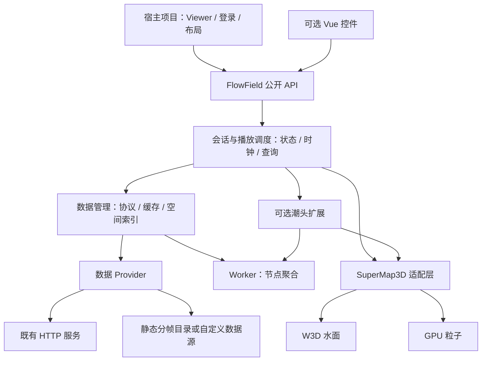

# 数字流场组件化评估与完整方案

> 2026-11-16 更新：当前五分钟播放、潮头清浊历史、倒影及钱塘江接入情况已变化。实施顺序和当前范围请以[最新 SDK 实施计划](数字流场SDK实施计划-2026-11-16.md)为准；本文保留原评估记录。

评估日期：2026-11-12  
文档状态：技术评估与建议实施方案，尚未实施组件化改造  
评估基线：本仓库当前工作区代码、交接文档、样例数据及运行库文件指纹

## 1. 建议决策

建议采用 **“独立流场 SDK + SuperMap3D 适配层 + 可选 Vue/TDesign 控件”** 的组件化方式。第一版面向已有 SuperMap3D Viewer 的项目，把数据加载、播放、渲染、查询和资源清理收敛到一个稳定入口；保留现有视觉效果与业务流程。

逻辑上分层，物理上先交付两个 npm 包，避免为了分层产生过多安装项：

| 交付项 | 建议名称（暂定） | 使用对象 |
|---|---|---|
| 无 UI 的 SDK | `@digital-flow/sdk` | 任意前端框架或原生 JavaScript 项目 |
| Vue 3 控件包 | `@digital-flow/vue-tdesign` | 使用 Vue 3 和 TDesign 的业务项目 |
| 引擎运行资源包 | `flow-runtime-<runtimeId>.zip` | 按需给没有兼容引擎资源的宿主配置，单独版本化 |
| 示例与文档 | 原生 JS 示例、Vue 示例、现有页面接入示例 | 接入、联调和升级验收 |

前端服务端接口、Python 数据转换工具、Java 发布读取服务继续独立维护。组件化不要求重写整条数据生产链。

首版目标是让接入方只需要提供 **Viewer、兼容运行库、数据源、可选配置**，无需了解 Worker、Primitive、纹理、缓存和图层销毁顺序。

本方案暂按“已有 SuperMap3D 项目复用”制定。多地图引擎、iframe 整页嵌入作为明确的后续分支，不作为首版成立的前提。

## 2. 现状评估：已经有什么，还缺什么

### 2.1 当前基线与旧方案的区别

2026-07-14 设计说明中的“纯静态、整场加载、不做后端与多场次”已经不能代表当前主工程。当前代码已具备：

- Java 服务发布及读取场次、Manifest、网格、单帧和过程线。
- Manifest 与共享网格加载、前两帧初始化、按窗口预取和有限缓存。
- Worker 单元数据转节点数据，以及按需潮头判识。
- W3D 水面、流速粒子、水面箭头、水位/流速着色和水质视觉预设。
- 场次选择、播放暂停、倍速、时间定位、点选和过程线。

但当前交接文档仍以“复制 `src/flowfield/`，参考页面接线”为主，且推荐代码仍使用旧 `WaterSurfacePrimitive`；实际页面已使用 `W3dWaterSurfaceLayer` 并增加潮头图层。应以代码为准更新交付基线。[本地证据 E1、E2、E3]

### 2.2 逐项结论

下表中“确定”指从当前源码可直接确认；“待验证”指本次未运行浏览器或性能测试，不能认定已发生故障。

| 项目 | 当前证据与判断 | 处理建议 | 优先级 |
|---|---|---|---|
| 数据加载 | 已有单帧接口、原始帧 12 帧缓存、节点帧 6 帧缓存、前 1 后 4 预取；值得复用 | 抽出 Provider 与调度器，保留现有协议 | P0 |
| 对外入口 | 页面自行创建 Data、Controller、水面、粒子、潮头和点击处理器 | 新增统一 `createFlowField()` 门面 | P0 |
| 页面耦合 | 页面依赖 `inject('getSync')`、`@` 别名、TDesign 提示，并固定飞向钱塘江 | Viewer 显式传入；相机定位、消息提示交给宿主 | P0 |
| UI 耦合 | 控件直接使用 `c.water`、`c.particles`、`c.data`，直接写 `c.speed` | 统一公开命令与状态，控件只调用 SDK | P0 |
| W3D 兼容 | 访问 `_waterDepthViews`、`_waterStageTexture`、`_lerpNum`、材质 `_uniforms` 等私有成员 | 私有访问集中在一个适配文件，锁定运行库指纹，建立冒烟验收 | P0 |
| 宿主共享状态 | W3D 初始化临时截获时钟监听并保存恢复时钟；还会在缺失时安装全局 `proj4` | 明确全局依赖与时钟保护责任；构造和初始化都放入异常恢复范围 | P0 |
| 资源路径 | W3D 配色纹理存在固定 `/libs/...` 路径 | 改为可配置资源清单；核查 W3D 内部法线资源寻址 | P0 |
| 时间语义 | 调度器使用帧索引作为 `simHour`，小数部分按 60 分钟换算 | 基于真实 `validTime` 调度；非整点间隔和单帧必须覆盖 | P0 |
| 生命周期 | 移除 Primitive 与 `destroy()` 的责任分散在页面、控制器和图层 | 一处统一拥有资源；销毁幂等、失败回滚、取消异步任务 | P0 |
| 着色与水质 | 水质文件明确只是材质预设，不参与等级判定 | 保留效果，明确来源类型，避免当作水质监测结果 | P0 |
| 潮头分析 | 默认钱塘江区域和固定阈值；平滑会读取前帧缓存 | 做成可选扩展；区域/阈值配置化，分析结果与视觉平滑分开 | P0 |
| 数据规模 | 转换脚本限制节点不超过 65,535；W3D 当前固定 256×256 纹理 | 首版声明并校验上限；更大网格需整体协议升级 | P0 校验，P1 扩容 |
| 两份源码 | 主工程与纯三维示例各有一套实现，且功能、路径已出现差异 | 改为同一个构建产物的两个消费者 | P0 |
| 性能与兼容 | 有历史验证记录，但缺少新组件包的实测 | 建立相同硬件、数据和场景下的基线对比 | P0 验收 |

P0 表示组件首版交付前必须完成；P1 表示有需求后扩展。以上问题主要说明组件交付边界尚不完整，并不意味着现有业务页全部不可用。

### 2.3 当前运行库并非同一份

本次实际计算 SHA-256：

| 文件 | SHA-256 |
|---|---|
| 主工程 `tdesign/public/libs/SuperMap3D/SuperMap3D.js` | `B59329245EBE142E428AD06D2BFD3E6467D0D15CCDAAC04CC7D534A14E00E057` |
| 纯三维示例 `supermap3d-pure3d-flow-test/public/libs/SuperMap3D/SuperMap3D.js` | `4B9EC76A75C3DA2507421F7252CEA97AC86910FFCAE49FD6C7D722A1475AD81C` |
| 两处 `w3d.umd.js`，文件指纹相同 | `21A2839096C1CD197537F3E68A2AE37B7B0C56685FC785BA0E35EFB64911E0F3` |

因此首版应以一个正式选定的运行库组合为主基线，另一个作为迁移兼容候选。不能仅凭“都是 SuperMap3D”声明通用兼容。完整资源包还需逐文件校验，单个 JS 指纹不代表整包一致。

纯三维示例目前通过 `meta.json + mesh.bin + frames.bin` 加载整场样例。其 README 中的浏览器结果是历史记录，可用于定位依赖，不等于当前 HTTP 数据链路或未来 SDK 产物已验收。[本地证据 E4]

## 3. 方案比较与取舍

| 方式 | 优点 | 主要代价 | 结论 |
|---|---|---|---|
| 继续复制目录 | 最快交接现有代码 | 每个项目维护分支，升级、缺陷修复和资源路径难统一 | 仅作过渡 |
| 封装一个大型 Vue 组件 | Vue 项目接入步骤少 | 仍绑定 UI、地图、数据源，原生 JS 项目无法直接复用核心 | 可作为 SDK 的组合控件 |
| SDK + 可选 Vue 控件 | 图层能力与页面解耦，接口稳定，可复用现有 Viewer | 需要补齐生命周期、运行库适配和产物验证 | **推荐** |
| iframe / 微前端整页 | 容易保留完整页面 | 与宿主地图共享、拾取、时钟和样式协作受限，可能重复加载引擎 | 用于明确要求独立整页的项目 |
| 首版同时支持 SuperMap3D、Cesium、二维地图 | 覆盖面大 | GPU 管线、场景 API 和生命周期需要分别实现与验收 | 留适配接口，按实际项目扩展 |

首版保留 W3D 作为正式水面路径。旧 `WaterSurfacePrimitive` 留作参考实现或兼容候选，不直接声明它是经过验收的自动降级路径。是否转为备用后端，由独立兼容测试决定。

## 4. 产品范围与责任边界

### 4.1 首版能力

| 能力 | 首版约定 |
|---|---|
| 地图接入 | 接收一个已创建且就绪的 SuperMap3D Viewer |
| 数据接入 | 现有 HTTP 服务；同协议静态分帧目录；自定义 Provider 接口 |
| 场次 | 指定内部 ID、业务 `sourceRunId` 或加载最新场次 |
| 水面 | 显隐、高程夸张、水位/流速/不着色、配色、水面箭头 |
| 粒子 | 显隐、质量档位、数量和线宽 |
| 时间 | 播放、暂停、倍率、真实时刻跳转、循环策略、缓冲状态 |
| 查询 | 经纬度取单元、当前时刻采样、完整过程线、可选屏幕拾取 |
| 扩展效果 | 水质视觉预设、可选潮头扩展；关闭时不做其专用分析 |
| 生命周期 | 加载取消、场次切换、错误恢复、卸载与资源释放 |
| UI | 场次选择、时间轴、控制面板、图例、查询弹窗，可独立组合 |

SDK 默认不自动播放、不移动相机、不接管全局鼠标交互。现有页面示例可显式开启自动播放并保留原默认视角，以维持现有体验。

首版正式验收范围为同页单个活动流场实例；重复挂载和跨路由使用必须稳定。多 Viewer、多流场叠加留到专门的并存验收后开放，不因接口面向对象就承诺已支持。

### 4.2 各方责任

| 责任方 | 负责事项 |
|---|---|
| 宿主项目 | Viewer、底图、地形、路由、登录鉴权、业务方案映射、布局、消息提示、显式相机操作 |
| 流场 SDK | 数据协议校验、帧调度、查询、图层管理、资源释放、状态和错误事件 |
| Vue 控件包 | 展示 SDK 状态、发送命令、主题和布局插槽 |
| 数据生产方 | 原始数据正确性、坐标/高程/单位定义、转换与发布、场次命名 |
| Java 服务与网关 | 场次可用性、只读接口、文件存储、访问控制、缓存和过期状态 |

SDK 不包含水动力求解，不从水色推断水质，不把涌潮可视化判识直接升级为业务预警结论。

## 5. 总体架构与工程组织



建议新增目录，逐步迁移，现有业务页保留为回归入口：

```text
packages/
  sdk/
    src/
      public/                 # 稳定 API、类型、事件、错误
      core/                   # 会话、播放时钟、帧调度、状态快照
      data/                   # 解码、Manifest 校验、缓存、空间索引
      providers/              # http / static / 自定义接口
      renderers/supermap3d/    # 水面、粒子、拾取、资源管理
      compatibility/w3d/      # W3D 私有访问与运行库检测的唯一位置
      plugins/tidal-front/    # 分析与可视化扩展
      workers/                # 聚合与分析任务
    dist/                     # ESM、类型、Worker、SDK 自有资源
  vue-tdesign/
    src/components/
    src/composables/
    src/style/
examples/
  vanilla-supermap3d/          # 直接导入已打包的 SDK
  vue-supermap3d/              # SDK + Vue 控件
runtime-manifests/            # 引擎组合、资源文件、指纹、能力范围
docs/componentization/       # 接入、API、数据、兼容、升级与验收
```

`@digital-flow/sdk` 采用子路径导出，例如 `/core`、`/supermap3d`、`/providers/http`、`/providers/static`、`/plugins/tidal-front`。核心和 Provider 不反向依赖 Vue、TDesign、W3D 或地图适配层。仅导入核心不会加载渲染库或访问 `window`。

公共接口与新调度代码优先使用 TypeScript；现有 GLSL 和成熟渲染代码可先保留 JavaScript，通过类型声明与适配器接入。首轮不把全面语法重写与组件化绑定在一起。

## 6. 对外 API 契约

以下均是**建议的新 API**，当前仓库尚不存在这些发布包和入口。

### 6.1 初始化与使用示例

```ts
import { createFlowField } from '@digital-flow/sdk'
import { createHttpProvider } from '@digital-flow/sdk/providers/http'
import { createSuperMap3DRenderer } from '@digital-flow/sdk/supermap3d'

// 依赖宿主已经加载兼容的 SuperMap3D、W3D 和所需资源。
const renderer = createSuperMap3DRenderer({
  viewer,
  runtime: { SuperMap3D, w3d },
  assets: runtimeAssetManifest,
})

const flow = createFlowField({
  renderer,                       // 交由 flow 管理，不能跨实例复用
  provider: createHttpProvider({
    baseUrl: '/flow-field',
    request: (url, init) => authenticatedFetch(url, init),
  }),
  playback: { autoPlay: false, loop: true, rate: 1 },
  cache: { rawFrames: 12, nodeFrames: 6, prefetchBefore: 1, prefetchAfter: 4 },
})

const offError = flow.on('error', error => showBusinessMessage(error.message))
const offState = flow.on('statechange', state => updateBusinessState(state))

// 定川业务 planId 由宿主明确映射为 sourceRunId。
await flow.loadScenario({ sourceRunId: planId })
flow.setOptions({ water: { visible: true }, particles: { quality: 'medium' } })
flow.play()
await flow.seek('2026-07-10T08:30:00+08:00')
const value = await flow.queryAt({ lon: 120.5, lat: 30.4 })
const series = value.cellIndex == null ? null : await flow.querySeries(value.cellIndex)

// 宿主卸载时执行；实际项目放在生命周期回调中。
offState()
offError()
await flow.destroy()
```

`authenticatedFetch`、`runtimeAssetManifest` 和业务展示函数由宿主提供；请求钩子必须原样传递 `signal`，保留二进制响应体，不能对二进制调用 JSON 解包。

### 6.2 方法定义

| 方法 | 语义 |
|---|---|
| `loadScenario(ref, { signal? })` | `ref` 是 `{scenarioId}`、`{sourceRunId}` 或 `{latest:true}` 三选一；新场次首个画面可用后完成 |
| `play()` / `pause()` | 控制流场自身时钟与动态效果，不更改宿主 Viewer 时钟 |
| `setPlaybackRate(rate)` | 正倍率；沿用旧体验时基准为每现实秒推进 1,800 模拟秒，明确记录该基准 |
| `seek(isoTime, { signal? })` | 跳到模型真实时刻；完成表示该时刻已成为显示时刻；后续跳转取消前次任务 |
| `setOptions(patch)` | 合并已声明配置并校验范围，返回最终生效配置；不允许任意写图层对象 |
| `setVisible(visible)` | 控制本实例所有视觉层；隐藏时暂停本实例推进与无必要预取 |
| `queryAt({lon, lat, time?}, {signal?})` | 按经纬度查询；默认查询显示时刻；指定时刻可按需取帧，返回完整状态 |
| `querySeries(cellIndex, {signal?})` | 返回带真实时刻、干湿状态和单位的过程线，绑定发起时的场次 |
| `pick(screenPosition)` | 只把屏幕坐标转为空间命中结果，不自动显示弹窗；未命中返回明确状态 |
| `getState()` | 不可变状态快照，不暴露 Viewer、图层、纹理及可变 TypedArray |
| `getCapabilities()` | 返回实际可用图层、功能、规模约束及降级原因 |
| `getDiagnostics()` | 返回缓存、请求、Worker、资源计数和时延统计，不含 Token |
| `on(event, listener)` | 返回取消订阅函数；订阅者异常应隔离，不能打断 SDK 渲染 |
| `destroy()` | 可等待的幂等销毁；第二次调用安全；之后的工作命令返回已销毁错误 |

`provider` 在首版作为无独立后台任务的传输对象，可共享；请求、缓存与 Worker 由每个会话拥有。SDK 取消自己创建的请求，不销毁宿主共享的鉴权客户端。

### 6.3 状态、事件与错误

生命周期 `phase`：`idle → loading → ready → destroyed`；首次加载失败为 `error`，可重新加载。播放、缓冲和切换为独立状态，避免混合成大量难组合的状态名。

```ts
type FlowState = {
  phase: 'idle' | 'loading' | 'ready' | 'error' | 'destroyed'
  scenarioId: string | null
  sourceRunId: string | null
  switching: boolean
  requestedTime: string | null
  displayedTime: string | null
  playing: boolean
  buffering: boolean
  suspended: boolean
  rate: number
  visible: boolean
  capabilities: FlowCapabilities
  options: Readonly<FlowOptions>
  lastError: FlowError | null
}
```

`requestedTime` 是用户想看的时间，`displayedTime` 是画面真正呈现的时间。缓冲期间值、图例、游标和查询以 `displayedTime` 为准，不能出现时间显示已跳转而画面还是旧帧的问题。

事件包括 `ready`、`statechange`、`timechange`、`progress`、`scenariochange`、`selection`、`warning`、`error`、`disposed`。高频 `timechange` 默认限制为每秒不超过 10 次，拖动完成和暂停等最终状态立即通知；GPU 更新频率与 UI 通知频率分开。

错误统一包含 `code`、`message`、`recoverable`、`operation` 和可选场次/帧号。至少覆盖：`AUTH_REQUIRED`、`FORBIDDEN`、`SCENARIO_NOT_FOUND`、`DATA_UNAVAILABLE`、`NETWORK_ERROR`、`INVALID_MANIFEST`、`INVALID_BINARY`、`UNSUPPORTED_RUNTIME`、`UNSUPPORTED_MESH`、`WORKER_FAILED`、`GPU_UNSUPPORTED`、`CONTEXT_LOST`、`DISPOSED`。主动取消作为 `AbortError` 结束，不弹失败提示。

## 7. 数据源、协议和数值语义

### 7.1 Provider 接口

```ts
interface FlowDataProvider {
  listScenarios?(context: RequestContext): Promise<ScenarioSummary[]>
  getManifest(ref: ScenarioRef, context: RequestContext): Promise<Manifest>
  getMesh(manifest: Manifest, context: RequestContext): Promise<ArrayBuffer>
  getFrame(manifest: Manifest, index: number, context: RequestContext): Promise<ArrayBuffer>
  getSeries?(manifest: Manifest, cell: number, context: RequestContext): Promise<CellSeries>
}
// RequestContext 至少包含 signal 与 requestId。
```

Provider 返回解压后的字节，SDK 做一致的解码、校验和缓存。`listScenarios` 缺失时隐藏场次选择；`getSeries` 缺失时隐藏完整过程线能力或返回不支持，不为了画一条曲线自动下载整场。

HTTP Provider 兼容现有 `/api/v1` 接口和 `{code,message,data}` JSON 外壳。先通过 Manifest 解析 `sourceRunId`，后续优先使用规范化的 `scenarioId` 和内容标识 `meshId`；保留后端已有的业务 ID 直查能力。

静态 Provider 使用相同 Manifest 与独立帧，部署时明确两种文件形式：带正确 `Content-Encoding: gzip` 的压缩文件，或直接提供原始 `.bin`。浏览器已按 HTTP 头解压的内容不得再次解压。把 `.gz` 文件直接放在没有相应响应头的静态服务器上，不属于已兼容的部署方式。

旧 `frames.bin` 全量入口仅保留为历史回归夹具，不作为正式 HTTP Provider 的回退。

### 7.2 协议兼容

第一版保留当前 `formatVersion: 2` 和 `FFM1` 网格布局。新增元信息采用兼容字段，破坏二进制布局时才启用新的明确版本。

| 字段组 | 约定 |
|---|---|
| 身份 | `scenarioId`、`sourceRunId`、`meshId`、数据修订标识；同名业务场次的内容变化必须有可辨识的新版本 |
| 时间 | `frames[].validTime` 带时区，严格递增且无重复；帧数与索引一致 |
| 空间 | 水平坐标明确为 WGS84 经纬度；垂直基准另行声明，不因经纬度是 WGS84 就推定水位高程基准 |
| 单位 | 水位及底高程 m，U/V m/s；U 向东、V 向北须由数据生产方确认并记录 |
| 量化 | 沿用 Manifest 中的缩放系数和 `drySentinel`，不把固定精度写死在通用解码器 |
| 完整性 | Manifest 计数、二进制魔数、字节长度、索引边界、时刻和有限数值校验 |
| 规模 | 当前生产协议节点数最多 65,535；更大网格明确拒绝，不能发生 uint16 截断 |
| 扩展 | `extensions.tidalFront` 等只被对应插件读取；未知可选字段可忽略 |

建议补充 `horizontalCrs`、`verticalDatum`、`units`、`velocityConvention`、`dataRevision`、`provenance`。历史数据缺少信息时标记 `unknown`，维持既有兼容读取，不猜测高程基准；涉及跨模型或地形精确叠加时需补齐元数据。

元数据默认值应只在模型 Profile 中声明；通用核心不放钱塘江区域或相机位置。

### 7.3 查询与绘图数值分开

- 点选数值来自原始单元帧；水面使用湿单元聚合后的节点帧。二者用途不同，不应互相替换。
- 时间插值先对 U/V 分量插值，再计算流速大小与流向；流向定义为正北 0°、顺时针，表示流向去向；零流速方向为 `null`。
- 两帧均干时返回 `dry`，水位、流速为 `null`，不能把干单元当作测得 0 值。
- 一干一湿时，首版可保留现有取湿帧值策略，但返回 `wetTransition: true` 和使用的策略；渲染的湿润透明度另行处理，不称为精确的干湿变化时刻。
- 域外、缺帧、干单元是三个不同状态；禁止统一返回 0。
- 高程夸张只影响画面，不能改变查询水位、过程线或导出值。
- 当前样例量化步长为水位 0.01 m、U/V 0.001 m/s。常规四舍五入量化分量误差上限分别为半步长；验收容差应另含浮点计算容差，并排除溢出和干湿转换样本。节点聚合差异不按单元量化误差评价。

## 8. 时间调度、缓存与错误恢复

### 8.1 按真实时间插值

内部使用 UTC 时间戳；显示时区默认 `Asia/Shanghai` 且可配置。找到 `timeA ≤ time ≤ timeB` 后计算：

```text
t = (time - timeA) / (timeB - timeA)
```

单帧场次按静态场展示，禁止访问第 1 帧。零帧、重复时间、倒序时间在 Manifest 校验时拒绝。越界跳转默认钳制到首末时间，并返回实际显示时刻。循环到首帧时清理粒子拖尾，避免跨时间段残影。

首版至少验收 1 帧、72 帧，以及间隔不等的序列。非整点数据用于验证时间引擎；不代表现有原始数据转换器已经支持所有新模型格式。

### 8.2 缓冲与重试

目标相邻帧未齐时保留上一有效画面，暂停显示时刻前进；默认同时冻结流场动态效果，明确表现为缓冲。显式暂停时模型时间、水面、粒子和潮头全部冻结；允许相机继续操作。

网络临时错误建议最多重试 2 次，指数退避并加少量随机抖动；鉴权错误、协议错误和明确不存在不自动重试。连续失败保留画面并通知宿主，禁止逐渲染帧无限重试。恢复播放时重置现实时间基准，避免补算后台积累时长。

后台标签页或全部流场层隐藏时进入挂起状态，保留用户播放意图；恢复时继续原时刻，不追赶不可见期间的时间。

### 8.3 缓存与取消

保留原始帧 12、节点帧 6、前 1 后 4 预取作为默认起点，增加字节上限和并发限制。当前显示 A/B 帧、正在处理的任务输入必须暂时固定，不能被 LRU 淘汰。

帧缓存键至少包含 Provider 命名空间、规范场次 ID、数据修订和帧序号；网格缓存键包含格式版本、`meshId` 与坐标约定。同一网格共享只读对象并计数引用，不能因为一个会话销毁而使另一个会话的缓冲区失效。

快速拖动使用递增 generation；旧请求即使晚到也不能覆盖新状态。取消窗口外预取，但按依赖集合保留当前任务所需帧；潮头分析需要前序帧，不能只按水面 A/B 帧裁剪请求。

Worker 输出可转移所有权；原始帧如果主线程缓存仍需使用，不直接 transfer 掉其底层 ArrayBuffer。Worker 出错时本次任务只重试或回退一次；主线程回退限频并报告降级。大网格无法满足交互预算时关闭重计算扩展，而非无上限阻塞 UI。

### 8.4 场次切换事务

顺序为：保留旧场次 → 取新 Manifest/网格/首帧 → 完成新图层必要资源初始化 → 一次性更新场次与画面 → 释放旧资源。

任何步骤失败，只清理新场次临时资源并保留旧场次。切换期间暂停旧播放，查询绑定旧 `displayedTime`；成功后按配置恢复播放。新请求取代旧请求、用户卸载和 Viewer 销毁均使切换任务失效。

双份资源暂存需要计入峰值内存。超过预算时拒绝无缝切换并返回可处理错误，宿主可以明确选择先卸载后加载；SDK 不悄悄破坏“失败保留旧场次”的契约。

## 9. SuperMap3D 与 W3D 适配方案

### 9.1 运行库注入与全局限制

SDK 接收 `runtime: { SuperMap3D, w3d }`，不把地图引擎重复打进自己的 JS。实际渲染对象必须来自创建 Viewer 的同一套运行库。

这里需要区分接口设计与现有 W3D 实现：传入对象并不自动消除 W3D UMD 内部对全局命名空间的依赖。纯三维示例设置了 `window.Cesium = window.SuperMap3D`，水面适配器还安装投影函数。首版应：

1. 提供页面级运行库配置说明或显式 bootstrap 工具，由宿主加载兼容引擎和 W3D。
2. 检查已有 `SuperMap3D`、`Cesium`、`w3d` 和投影函数是否冲突；发现冲突直接给出可操作错误，不覆盖宿主已有对象。
3. 通用 SDK 不安装简化版全局 `proj4`；优先让宿主提供兼容投影依赖。若供应方提供可注入接口，再从适配层接入。
4. 正式声明首版只支持同页一套兼容引擎运行时。不同引擎版本同页并存不纳入首版承诺。

组件核心可做到框架无关；W3D 运行时仍有明确前提，不能写成“没有任何全局依赖”。

### 9.2 私有接口集中管理

水面适配器通过 `W3dBridge` 管理私有字段：创建、输入 A/B 帧、插值、材质参数、动画时间和销毁。业务代码与 UI 不直接接触 `_water*`、`_uniforms`、`_palyState` 等成员。

建立 `runtimeId → 引擎指纹 + W3D 指纹 + 必要成员检查 + 资源清单 + 验收报告`。运行时能力检查只能发现明显不兼容，不能替代真实渲染验收。

时钟截获如短期无法消除，应限定为同步初始化的兼容措施，保存与恢复都放在 `try/finally` 中，并覆盖 `new WaterFloodSimulation()` 本身抛异常的路径。后续优先采用供应方公开的关闭内部时钟或外部输入接口。

### 9.3 资源所有权

| 资源 | 所有者 | 清理规则 |
|---|---|---|
| Viewer、相机、底图、地形、宿主实体 | 宿主 | SDK 不销毁、不清空 |
| SDK 创建的粒子与潮头 Primitive | 渲染适配器 | 从所属集合移除并精确销毁一次 |
| W3D 自己创建的 Primitive、纹理与监听 | W3dBridge | 按 W3D 实际所有权清理，不当作普通图层重复加入/移除 |
| SDK 自有查询标记和点击处理器 | 交互适配器 | 仅移除自身创建的对象 |
| Worker、帧请求、订阅、缓存引用 | 会话 | 取消、终止、解绑、减引用并清理 |
| 宿主共享运行库及默认纹理 | 宿主/引擎 | 不销毁 |

建议为 SDK 自有 Primitive 使用独立子集合，明确 `destroyPrimitives` 策略并登记 disposer；不要修改宿主根集合的销毁策略。W3D 对象按其自身实际生命周期单独管理。

销毁顺序：标记终止并使 generation 失效 → 停止推进与订阅 → 取消网络和 Worker 任务 → 移除自身交互标记 → 释放图层和 GPU 资源 → 释放数据引用 → 清理监听。异常释放应继续处理剩余资源并汇总诊断。

Cesium 官方文档说明 PrimitiveCollection 默认在移除时销毁成员，因此“remove 后无条件再 destroy”不是安全的通用规则。此处仅以其 API 语义作为设计参考；本项目 SuperMap3D 分支仍需以实际版本验证。[PrimitiveCollection 官方文档](https://cesium.com/learn/cesiumjs/ref-doc/PrimitiveCollection.html)

### 9.4 渲染调度与降级

暂停、隐藏和没有脏数据时，SDK 不应持续主动 `requestRender()`。相机移动、窗口尺寸变化或设置修改时仍需重绘静态结果；宿主可能因为其他图层持续渲染，不将整个 Viewer 的空闲责任归于 SDK。

初始化检测 WebGL、纹理容量及粒子离屏渲染所需能力：能力足够时使用水面与粒子；粒子能力不足时关闭粒子并保留可用水面与查询；W3D 不可用时保留数据查询能力并向宿主报告水面不可用。旧自定义水面只有通过单独验收后才能成为可选回退。

GPU 上下文丢失时暂停并报告；具备可靠重建能力后再自动恢复，否则提供显式重新初始化入口。不能只在控制台打印一次后让 UI 继续显示图层正常。

## 10. Vue 控件与交互设计

保留当前面板视觉和“数字流场、水面效果、水面箭头、潮头位置、粒子效果、水位夸张、着色、水质效果”等业务名称，在结构上拆成两种用法：

| 用法 | 建议接口 | 生命周期 |
|---|---|---|
| 完整组合组件 | `<DigitalFlowField :viewer :runtime :provider :options />` | 内部创建并拥有一个 SDK 实例；卸载时销毁 |
| 独立控件 | `<FlowTimeline :flow />`、`<FlowControls :flow />` 等 | 外部持有 SDK；控件卸载只取消订阅 |

独立控件包括 `ScenarioSelector`、`FlowTimeline`、`FlowControls`、`FlowLegend`、`FlowQueryPopup`。可提供 `useFlowFieldState(flow)` 将不可变快照映射为 Vue 响应状态；`flow` 变化时先取消旧订阅再订阅新对象。

组件包将 Vue 与 TDesign 声明为外部/peer 依赖，显式导入实际使用的控件，不要求宿主配置项目专用自动导入插件、`@` 别名、Pinia 或路由。核心 SDK 不依赖它们。

布局使用局部容器、`ff-` 类名前缀和 CSS 变量，提供工具栏、图例、加载态、空态、查询弹窗插槽。层级、宽度、停靠位置和颜色可配置；移除过程线文案里写死的“72 时次”，实际数量来自 Manifest。

所有控件通过 SDK 命令更新状态，禁止直接写 `flow.water.show`、`flow.particles.setCount()` 或内部缓存。切换场次后保持已选配色、粒子档位和显示设置，数据不支持的配置通过能力信息明确回退。

点击查询默认由宿主调用 `pick()` / `queryAt()`；组合组件可提供显式 `interaction.enabled`。不要替换宿主已有 LEFT_CLICK 回调。查询命中发出 `selection`，是否打开弹窗由宿主决定。

## 11. 潮头与水质扩展的处理

### 11.1 潮头扩展

潮头算法属于模型相关能力，首版从通用 Data 和 Controller 中剥离为可选扩展，但在现有钱塘江示例中继续可用。

扩展配置包括区域多边形、分析参数、算法版本和适用时间分辨率。通用包不默认套用钱塘江区域；钱塘江 Profile 显式携带现有默认值。

原始判识结果应由指定数据与参数确定，不能因用户之前播放过哪些帧而改变。当前“前一帧弱余波保留”属于视觉平滑，应放在展示状态中，并在跳转和场次切换时重置。验收同一时刻的顺序播放与直接跳转应得到相同原始判识结果。

当前算法基于相邻时次变化和固定阈值，首版暂将其适用范围限定为已有模型及经过验证的时间步长。时间引擎支持非等间隔并不意味着潮头阈值已经适用于任意间隔；其他步长需归一化并重新校核，未满足时明确关闭该扩展。

输出附带 `algorithmVersion`、`parameters`、`validTime`、`sourceRunId` 和 `derived: true`。没有专家标注样本前，只交付“模型数据驱动的潮头判识与展示”能力，不报告未经验证的识别准确率。

### 11.2 水质视觉预设

保留 I、II、III、IV、V、劣 V 等既有视觉选项，但状态区分 `visual-preset` 与 `observed-class`。手动选色显示为“水质效果（预设）”；只有真正接入经确认的业务等级数据时，才显示数据来源和时刻。颜色变化不修改水动力数值。

## 12. 构建、发布与部署

### 12.1 包产物

SDK 交付 ESM、`.d.ts`、明确的 `exports`、Worker 文件和 SDK 自有资源；Vue 包另提供 CSS 导出。先满足现代构建工程和原生 ESM 页面，UMD 单脚本接入可按真实需求增补。

采用库模式构建，并把 Vue 等宿主依赖外置，是可行的发布路线；Vite 官方同时说明库模式会静态替换 `import.meta.env.*`，因此 API 地址应作为运行时参数传入，不能把某个项目的 `VITE_FLOW_API_BASE` 编进公共 SDK。[Vite 库模式文档](https://vite.dev/guide/build.html#library-mode)

首版沿用经锁定验证的 Vite 7 工具链，不把引擎组件化和构建工具大版本升级一起进行。当前在线文档可能对应更新主版本，配置字段必须以仓库锁定版本验证。

`sideEffects` 要保留必要 CSS，子路径导出与实际产物逐一对应；源码路径别名不得泄漏到发布文件。SDK 发布版本、服务版本和数据 `formatVersion` 是三个独立维度，兼容表分别列出。

### 12.2 Worker 与资源寻址

默认 Worker 相对 SDK 模块定位，同时提供 `workerUrl` 或 `workerFactory` 供严格 CSP、资源代理或特殊构建器使用。必须在安装后的发布包中验证，而不能只看源码项目中的开发模式。

Vite 支持 `new Worker(new URL(..., import.meta.url))` 的构建识别；这说明当前写法可以作为起点，但不自动保证经过库打包、二次打包和子目录部署之后仍正确。[Vite Worker 文档](https://vite.dev/guide/features.html#web-workers)

引擎运行资源与 SDK 自有资源分开管理。资源清单至少包括文件路径、相对根目录、长度、SHA-256 和来源版本。不能只交付 `SuperMap3D.js`；需覆盖实际依赖的 Workers、Assets、Widgets 及其他目录，并补齐当前 W3D 使用的法线、色表等伴随文件。[本地证据 E4]

W3D 当前写死的色表路径改为资源 URL 输入；其内部默认法线路径若不可配置，首版保留兼容目录布局并由资源清单校验，后续再推动公开资源注入接口。不能声称改一个 `assetBaseUrl` 就已消除第三方内部所有固定路径。

### 12.3 服务端与网关

主链路继续使用现有 Java 服务 1.0.1 接口。浏览器只读请求使用宿主鉴权；发布 Token 只保留在转换发布端，不进入 SDK 配置或前端产物。

同域优先代理 `/flow-field`，保留后端上下文路径；网格和帧透传 gzip 及缓存相关响应头。鉴权跨域、Cookie、CORS 如有需要由宿主网关明确配置，作为接入测试项目。

内容不变的网格和版本化帧 URL 可长期缓存；场次列表和 `latest` 不采用 immutable。若业务要覆盖同一 `sourceRunId` 的数据，应先明确修订身份、URL 与缓存策略，不能在保持旧 URL 的同时默默替换内容。

服务端 READY 内容幂等、过期场次再发布和保留策略需要一起回归。该项属于缓存身份约束的确认，不依据本次只读检查直接断定服务端已经发生错缓存。

### 12.4 交付方式与升级

首先提供 `npm pack` 生成的 `.tgz`，在干净消费者工程中安装验收；有现成私有制品库时再发布同一产物。运行资源包由交付方确认可分发范围，并附完整清单；宿主已有兼容资源时允许直接引用。

版本采用语义化规则：公开 API 或协议行为破坏兼容时升主版本；增加可选能力升次版本；修复升补丁版本。每次升级附“SDK × Vue 包 × 服务协议 × 运行库指纹”的验证矩阵及迁移说明。

## 13. 性能预算与验证方法

以下数字均为建议验收门槛或静态计算，不是本次运行实测。

### 13.1 以当前样例估算开销

当前样例为 38,081 节点、71,958 单元、72 帧：

| 项目 | 估算 |
|---|---|
| 单个原始帧 | `71,958 × 3 × 2 = 431,748 B`，约 421.6 KiB |
| 12 个原始帧 | 约 4.94 MiB |
| 单个节点帧 | `38,081 × 4 × 4 = 609,296 B` |
| 6 个节点帧 | 约 3.49 MiB |
| 原始网格 | 2,040,064 B，约 1.95 MiB |
| 上述数据合计 | 约 10.37 MiB，不含索引、临时副本、Worker、W3D 与 GPU |
| 样例压缩网格 + 前两帧 | 约 1.75 MiB，不含 Manifest、引擎资源、协议开销和随后预取 |
| 单张 2048×1024 RGBA32F 流场纹理 | 32 MiB；还存在粒子纹理、拖尾缓冲等 |

内存不能只看 12 帧缓存。GPU 纹理与拖尾分辨率同样需要质量档位和预算控制。建议数据缓存先设 64 MiB 字节上限（不代表总页面内存上限），GPU 独立估算并记录。

### 13.2 建议质量档位

| 档位 | 粒子数量起点 | 流场纹理起点 | 用途 |
|---|---:|---|---|
| low | 128×128 = 16,384 | 1024×512 | 核显或大屏多业务负载 |
| medium | 256×256 = 65,536 | 2048×1024 | 默认桌面配置 |
| high | 512×512 = 262,144 | 2048×1024 或经实测上调 | 独显、按需选择 |

拖尾分辨率、设备像素比和帧率共同影响成本，应一起设上限。首版提供显式档位与能力提示；自适应切档需有滞后和最小保持时间，避免反复重建资源。

### 13.3 建议验收门槛

| 指标 | 条件与目标 |
|---|---|
| 首个有效画面 | Viewer 与运行库已就绪；当前样例；50 Mbps、RTT ≤50 ms 测试环境下，10 次冷数据加载 P95 ≤3 秒 |
| 流畅性 | 1920×1080、DPR=1、固定视角/相机路径；medium 档在指定核显设备中位 FPS ≥30，独显目标 60；记录 P95 帧耗时 |
| 封装回归 | 同设备、数据、画质、运行库条件下，稳态 FPS 降幅 ≤10%，否则查清额外成本 |
| 跳转响应 | 缓存命中时从命令到画面更新 P95 ≤100 ms；未命中按网络时间单独记录 |
| 空闲行为 | 暂停/隐藏且相机静止时，本实例不持续发起预取或主动渲染请求 |
| 稳定性 | 连续播放 30 分钟、场次切换 50 次、挂载卸载 20 次，无未处理异常和持续资源增长 |
| 销毁 | 自有监听、Worker、未完成任务与图层注册计数归零，宿主图层和时钟状态保留 |

设备型号、GPU 驱动、浏览器、运行库指纹、数据版本和网络条件必须写入报告。若原实现达不到某个建议目标，先报告基线与差距，再决定质量档位或专项优化，不将这些数字当作已验证承诺。

## 14. 实施路线与工作量

### 14.1 分阶段迁移

| 阶段 | 核心工作 | 阶段出口 | 估算开发人日 |
|---|---|---|---:|
| M0 基线冻结 | 梳理当前功能、运行库与资源、数据协议、公开 API、记录原页面效果及性能 | 基线清单、契约、样例和运行库组合可追溯 | 3–4 |
| M1 SDK 核心 | Provider、真实时间调度、缓存/取消、查询、统一状态与错误 | 无 UI 消费者可加载、定位、查询；关键数据行为回归通过 | 6–8 |
| M2 渲染适配 | W3dBridge、私有访问集中、资源路径、生命周期、失败回滚、质量配置 | 新 SDK 在选定运行库下与旧页面效果一致 | 7–9 |
| M3 UI 与业务迁移 | 两种 Vue 用法、移除内部对象访问、潮头扩展、切换原页面接入 | 原业务流程保留，两个示例消费同一包 | 4–5 |
| M4 发布与联调整改 | Worker/产物验证、子目录部署、文档、部署示例、问题收敛 | 安装 `.tgz` 的干净工程和目标宿主验收通过 | 4–6 |

前端开发合计约 **24–32 人日**；服务/网关联调约 **2–3 人日**；专项测试约 **4–7 人日**，整体约 **30–42 人日**。这是基于现有渲染实现可复用、数据协议不重构、一个主要运行库组合的估算，不是固定报价。

配置一名熟悉渲染的开发、一名负责接入/UI 的开发并有测试与服务端配合，建议按 **4–6 周日历工期** 规划；单人完成全部工作需要相应延长。W3D 兼容修订、第二套引擎正式支持、大网格或新模型接入单独估算。

### 14.2 文件迁移映射

| 当前实现 | 目标位置/处理 |
|---|---|
| `FlowFieldData.js` | 拆为 Provider、二进制解码、网格索引、帧缓存；潮头专有逻辑移到插件 |
| `FlowFieldController.js` | 拆为会话、真实时间时钟、帧调度；不暴露具体水面/粒子对象 |
| `W3dWaterSurfaceLayer.js` | 保留效果逻辑，抽出 W3dBridge、配置、资源与所有权 |
| `ParticleFlowLayer.js` | 接受运行库与帧输入，补能力报告、质量参数和完整资源清理 |
| `flowFieldWorker.js` | 统一任务协议；聚合与插件分析按需加载；补取消/过期结果隔离 |
| `tidal-front-analysis.js`、`tidal-front-layer.js` | 可选扩展，区域、参数与显示平滑分离 |
| `components/*.vue` | 保持视觉，改为公开 API + 状态驱动 |
| `views/flow-field.vue` | 保留宿主接线、业务方案映射、布局和相机策略 |
| 纯三维示例中的复制源码 | 在 SDK 验收后替换为发布包依赖，保留样例回归入口 |
| Python 与 Java 服务 | 保持既有生产链路，补协议契约和必要联调修正 |

### 14.3 回滚方案

迁移期间新旧实现放在独立入口/路由中，避免同一个 Viewer 同时加载两套流场。由宿主选择旧实现或 SDK 实现，SDK 验收通过后再切换默认入口。

保留旧源码和对应运行资源基线到首个发布周期结束；回滚时先完成当前 SDK 销毁，再进入旧入口。包版本和资源包同时锁定，避免只回滚 JS 而保留不兼容的运行库。

## 15. 首版验收清单

这些是后续实施需要完成的验收项，本次没有执行，也不能标为已通过。

| 类别 | 必须覆盖的场景 | 通过证据 |
|---|---|---|
| 真实数值 | 湿/干/转换单元，原始 DAT 到量化帧再到 API 查询，U/V 与流速方向 | 抽样表、容差定义、失败样本；精度与模型正确性分别评价 |
| 时间 | 首末帧、单帧、非等间隔、越界、暂停、倍速、循环、后台恢复 | 自动化断言及可复核时刻记录 |
| 帧调度 | 快拖、连续拖、旧请求晚到、窗口外取消、Worker 失败 | 请求和 generation 日志、最终画面时刻 |
| 场次切换 | 同网格复用、异网格、加载失败、GPU 初始化失败、切换中卸载 | 旧场次保留、无残留、缓存命中证据 |
| 网络与鉴权 | 401/403、404/过期、超时、损坏 Manifest/帧、断网恢复 | 错误代码、有限重试、UI 状态一致 |
| 渲染 | 水面、箭头、粒子、图例、高程夸张、配色、水质预设、潮头 | 与基线截图/视频及数值行为对照 |
| 宿主兼容 | Viewer 时钟、相机、其他 Primitive、已有点击功能 | 前后状态与资源计数；完整业务回归 |
| 包接入 | 原生 JS 和 Vue 消费已打包 `.tgz`，不用源码别名 | 干净目录安装、构建、运行记录 |
| 部署 | 域名根目录、`/onemap/` 等子目录、Worker 文件、纹理、gzip | Network/HAR、资源 SHA-256、无 404 |
| 生命周期 | 挂载卸载 20 次，销毁中晚到回调，Viewer 提前销毁 | 无宿主误删、自有计数归零、无未处理 Promise |
| 性能 | 第 13 节的限定条件和稳定性场景 | FPS/时延/内存曲线与设备信息 |
| 潮头算法 | 顺序播放与直接跳转一致，区域外无误用，时间分辨率约束 | 判识结果对照；业务准确性另有专家样本验收 |

纯协议用例可使用明确标注的合成夹具，例如单帧、缺帧、乱序时间和超大节点。视觉与数值回归使用真实来源样例；业务认可仍需目标平台和专业人员验收。

不能仅以 `build` 成功作为组件交付完成：必须验证发布产物、真实资源加载、生命周期和宿主接入。最终区分“代码完成、包验收、目标环境联调、业务验收”四个状态。

## 16. 主要风险与暂缓事项

| 风险/未知项 | 当前判断 | 对策 |
|---|---|---|
| W3D 私有接口升级 | 当前确有依赖，升级可能破坏水面 | 锁指纹、集中适配、完整资源清单、升级回归 |
| W3D 全局状态与时钟 | 当前已有兼容补丁，任意多实例兼容未经证实 | 首版限制运行时范围，做异常恢复；并存能力单独开放 |
| 大网格 | 当前转换和渲染都存在容量限制 | 明确拒绝；未来同步升级索引、二进制、服务校验、W3D 纹理与粒子路径 |
| 高程与模型单位 | 当前元信息不足以声明通用精确叠加 | 补模型 Profile，缺失显示未知，正式叠加前校核 |
| 潮头准确性 | 有算法实现，无本次独立真值评估 | 参数版本化、原始判识可重复、专业验收另列 |
| 生产性能 | 历史记录不能代替新包实测 | 对照同一基线，明确设备与网络条件 |
| 时间与工期 | 依赖供应方接口和目标宿主配合 | M0 固定基线；范围变化单独估算 |

建议暂缓：多地图引擎全量适配、二维 GPU 实现、移动端、多流场并存、超 65,535 节点扩容、WebGPU 重写、插件市场、通用工作流编排、复杂微前端体系。这些不阻止首版形成稳定可复用的组件。

启动实施时需要落定的项目参数只有：首个接入宿主及 Viewer 创建方式、正式引擎资源组合、数据服务与鉴权方式、目标硬件/浏览器、是否必须首版多实例。未明确前按本文默认边界估算，不将未知项写成已支持。

## 17. 应交付的完整材料

1. 两个可安装的 `.tgz` 包及源码、锁文件、构建说明。
2. SDK API/类型/事件/错误说明与数据 Provider 契约。
3. 引擎运行资源清单、版本指纹和已验证兼容矩阵。
4. 原生 JS、Vue、现有业务页三个接入示例，共用同一 SDK 产物。
5. 真实样例及来源说明、仅用于边界测试的合成夹具说明。
6. HTTP 与静态分帧部署说明，Worker、gzip、子目录和鉴权配置示例。
7. 数值、生命周期、性能、发布产物和目标宿主的验收报告。
8. 升级与回滚说明、已知限制、后续扩展清单。

## 18. 本次评估证据与限制

本次完成了仓库文档和源码核查、样例元数据读取、引擎文件指纹计算及官方构建/生命周期文档核对。没有改动业务代码，没有启动浏览器、构建或测试。仓库已有大量未提交修改，本方案基于当前工作区，不仅基于 Git HEAD。

本次唯一新增交付是本方案文档；前述包名、目录、API、性能指标及排期均是建议目标。

| 编号 | 本地证据 | 用途 |
|---|---|---|
| E1 | [原设计说明](../superpowers/specs/2026-07-14-digital-flow-field-design.md)、[前端集成说明](../handover/数字流场前端集成说明-定川.md) | 判断早期方案、当前交接方式与代码之间的差异 |
| E2 | [业务页面](../../tdesign/src/views/flow-field.vue)、[控件目录](../../tdesign/src/flowfield/components) | 当前创建/销毁/拾取流程与 UI 耦合 |
| E3 | [Data](../../tdesign/src/flowfield/FlowFieldData.js)、[Controller](../../tdesign/src/flowfield/FlowFieldController.js)、[W3D 水面](../../tdesign/src/flowfield/W3dWaterSurfaceLayer.js)、[粒子](../../tdesign/src/flowfield/ParticleFlowLayer.js) | 缓存、时间语义、私有接口与资源策略 |
| E4 | [纯三维示例](../../supermap3d-pure3d-flow-test/README.md)、[依赖说明](../../supermap3d-pure3d-flow-test/public/docs/dependency-integration.md)、[示例入口](../../supermap3d-pure3d-flow-test/src/main.js) | 独立三维依赖、历史验证范围和静态全量入口 |
| E5 | [潮头分析](../../tdesign/src/flowfield/tidal-front-analysis.js)、[水质预设](../../tdesign/src/flowfield/waterQualityPresets.js) | 模型区域、算法参数与视觉效果边界 |
| E6 | [服务说明](../../flow-field-service/README.md)、[只读接口](../../flow-field-service/src/main/java/com/supermap/model/flowfield/web/FlowQueryController.java)、[转换工具](../../tools/preprocess_flowfield.py) | 接口与格式兼容、节点上限、二进制协议 |
| E7 | [历史联调验收记录](../../deploy/qiantangjiang-flow-field/验收记录.md)、[样例元信息](../../supermap3d-pure3d-flow-test/public/data/flowfield/meta.json) | 数据规模与既有验证范围；不作为本次运行结果 |


