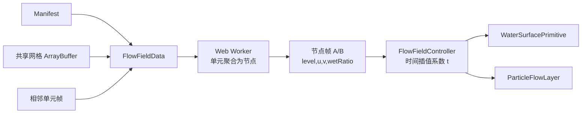

# 数字流场前端集成说明

> 交接对象：定川前端开发人员  
> 功能范围：风暴潮二维水动力数字流场的场次选择、水位面、流速粒子、时间轴、点选瞬时值和过程线  
> 当前技术栈：Vue 3、TDesign Vue Next、SuperMap3D

## 1. 集成结论

数字流场功能已经从“浏览器一次下载整场数据”调整为“按场次、网格和单帧调用接口”。

前端首屏只请求：

1. 场次 Manifest。
2. 一份共享网格。
3. 第 0 帧和第 1 帧。

播放过程中按时间窗口预取帧，浏览器内保留有限缓存，不下载原始 DAT，也不下载整场 `frames.bin`。

推荐的集成方式是将 `tdesign/src/flowfield/` 整个目录复制到基座项目，并参考现有
`tdesign/src/views/flow-field.vue` 完成 Viewer 接入和组件布局。

## 2. 代码位置

### 2.1 页面入口

| 文件 | 作用 |
|---|---|
| `tdesign/src/views/flow-field.vue` | 完整页面示例，负责加载场次、创建图层、时间轴、点选和销毁 |

### 2.2 核心代码

| 文件 | 作用 |
|---|---|
| `tdesign/src/flowfield/FlowFieldData.js` | 接口调用、网格解码、单帧解码、LRU 缓存、预取、空间拾取和过程线查询 |
| `tdesign/src/flowfield/FlowFieldController.js` | 模拟时钟、相邻帧调度、时间插值、缓冲状态和图层数据推送 |
| `tdesign/src/flowfield/flowFieldWorker.js` | 将单元数据聚合为节点数据，避免阻塞浏览器主线程 |
| `tdesign/src/flowfield/WaterSurfacePrimitive.js` | SuperMap3D 水位面 Primitive，支持水位/流速着色和水面效果 |
| `tdesign/src/flowfield/ParticleFlowLayer.js` | SuperMap3D GPU 粒子流场图层 |
| `tdesign/src/flowfield/waterNormalTexture.js` | 水面法线纹理 |

### 2.3 交互组件

| 文件 | 作用 |
|---|---|
| `components/ScenarioSelector.vue` | 可用场次选择 |
| `components/TimelineBar.vue` | 播放、倍速、时间拖动和“缓冲中”提示 |
| `components/ControlPanel.vue` | 水面、粒子、夸张系数、粒子数量和着色控制 |
| `components/QueryPopup.vue` | 点选后的瞬时值和过程线弹窗 |
| `components/MiniChart.vue` | 72 时次水位/流速过程线 |
| `components/SpeedLegend.vue` | 水位或流速图例 |

### 2.4 后端接口实现位置

| 文件 | 作用 |
|---|---|
| `flow-field-service/.../web/FlowQueryController.java` | 前端只读接口 |
| `flow-field-service/.../service/QueryService.java` | Manifest、网格、帧和过程线查询 |

## 3. 运行前提

基座项目至少需要：

- Vue 3。
- `tdesign-vue-next`，并完成组件全局注册或按需自动导入。
- 可用的 SuperMap3D JavaScript 和静态资源。
- Vite 对 `new Worker(new URL(..., import.meta.url))` 的构建支持。
- `@` 指向项目 `src` 目录；若基座别名不同，需要调整 import 路径。

### 3.1 SuperMap3D Viewer

当前渲染代码使用全局对象 `SuperMap3D`，基座必须已经初始化可用的
`SuperMap3D.Viewer`。

现有页面通过：

```js
const syncRef = inject('getSync')
const viewer = syncRef.value.viewer
```

取得 Viewer。集成到新基座时，可以替换为基座自己的 Viewer 获取方式，其余核心代码不需要修改。

如果直接复用完整页面，还需要在基座路由中注册 `flow-field.vue`；如果只复用图层能力，则使用第 6 节的最小集成代码。

### 3.2 API 根路径

构建时配置：

```env
VITE_FLOW_API_BASE=/flow-field
```

读取优先级为：

1. `import.meta.env.VITE_FLOW_API_BASE`
2. `window.FLOW_FIELD_API_BASE`
3. 默认值 `/flow-field`

如果前端和流场服务同域，建议由网关代理：

```text
/flow-field/*  ->  http://sgxt-flow-field:8793/flow-field/*
```

不要将 `/flow-field` 重写掉。后端自身的 Servlet Context Path 就是 `/flow-field`。

## 4. 前端只读接口

JSON 接口统一返回：

```json
{
  "code": 0,
  "message": "OK",
  "data": {}
}
```

`FlowFieldData.js` 已自动取出 `data`，业务层不需要重复解包。

| 方法 | 地址 | 用途 |
|---|---|---|
| GET | `/flow-field/api/v1/scenarios` | 查询最近可用场次 |
| GET | `/flow-field/api/v1/scenarios/latest/manifest` | 获取最新可用场次 Manifest |
| GET | `/flow-field/api/v1/scenarios/{id}/manifest` | 获取指定场次 Manifest，`id` 支持 `scenarioId/sourceRunId` |
| GET | `/flow-field/api/v1/meshes/{id}` | 获取共享网格，`id` 支持 `meshId/sourceRunId` |
| GET | `/flow-field/api/v1/scenarios/{id}/frames/{index}` | 获取单个时次帧，`id` 支持 `scenarioId/sourceRunId` |
| GET | `/flow-field/api/v1/scenarios/{id}/cells/{cellIndex}/series` | 获取完整过程线，`id` 支持 `scenarioId/sourceRunId` |

只有状态为 `READY` 且文件可用的场次会出现在前端列表中。

### 4.1 定川 planId 直接查询（1.0.1）

定川平台的 `planId` 必须与河口院发布包中的 `sourceRunId` 一致。1.0.1 起，Manifest、
网格、帧和过程线的原接口均可直接把 `planId` 放入原路径参数，不需要先查询 Manifest
换取内部 `scenarioId`。例如：

```text
/flow-field/api/v1/scenarios/20260818091757/manifest
/flow-field/api/v1/meshes/20260818091757
/flow-field/api/v1/scenarios/20260818091757/frames/0
/flow-field/api/v1/scenarios/20260818091757/cells/1000/series
```

接口响应内容、gzip、ETag 和缓存规则不变；原有 UUID 和 `meshId` 调用方式继续兼容。

### 4.2 场次列表示例

```json
[
  {
    "id": "a9ef0b33-xxxx-xxxx-xxxx-6ef2e148f451",
    "sourceRunId": "RST-WUV-202607110800",
    "name": "2026年7月11日08时预报",
    "modelVersion": "qiantang-v1",
    "meshId": "eaeb6d6438f90eb5...",
    "startTime": "2026-07-09T08:00:00+08:00",
    "endTime": "2026-07-12T07:00:00+08:00",
    "frameCount": 72,
    "publishedAt": "2026-07-29T22:00:00+08:00"
  }
]
```

### 4.3 Manifest 关键字段

```json
{
  "formatVersion": 2,
  "scenarioId": "a9ef0b33-xxxx-xxxx-xxxx-6ef2e148f451",
  "sourceRunId": "RST-WUV-202607110800",
  "scenarioName": "2026年7月11日08时预报",
  "modelVersion": "qiantang-v1",
  "startTime": "2026-07-09T08:00:00+08:00",
  "endTime": "2026-07-12T07:00:00+08:00",
  "nNodes": 38081,
  "nCells": 71958,
  "nTris": 71958,
  "nFrames": 72,
  "bbox": [115.85, 19.34, 139.04, 42.38],
  "scales": {
    "level": 0.01,
    "uv": 0.001
  },
  "drySentinel": -32768,
  "mesh": {
    "meshId": "eaeb6d6438f90eb5...",
    "rawLength": 2040064,
    "compressedLength": 1377118
  },
  "frames": [
    {
      "index": 0,
      "validTime": "2026-07-09T08:00:00+08:00",
      "rawLength": 431748,
      "compressedLength": 230357
    }
  ],
  "stats": {
    "levelMin": -2.1,
    "levelMax": 3.2,
    "speedMax": 2.5
  }
}
```

前端时间轴使用 `frames[].validTime`，不要根据帧序号自行推算日期。

### 4.4 过程线返回示例

```json
{
  "scenarioId": "a9ef0b33-xxxx-xxxx-xxxx-6ef2e148f451",
  "cellIndex": 1000,
  "points": [
    {
      "frameIndex": 0,
      "validTime": "2026-07-09T08:00:00+08:00",
      "dry": false,
      "level": 1.23,
      "u": 0.125,
      "v": -0.036
    }
  ]
}
```

流速大小由前端计算：

```js
const speed = Math.hypot(point.u, point.v)
```

## 5. 二进制数据协议

### 5.1 HTTP 响应

网格和帧接口返回：

```text
Content-Type: application/octet-stream
Content-Encoding: gzip
Content-Length: 压缩文件长度
ETag: 压缩文件 SHA-256
Cache-Control: public, max-age=31536000, immutable
```

重要：浏览器 `fetch()` 会根据 `Content-Encoding: gzip` 自动解压。

因此：

```js
const buffer = await response.arrayBuffer()
```

得到的是解压后的原始二进制。前端不要再次调用 gzip 解压库，否则会报错。

如果经过 Nginx 或其他网关，必须保留 `Content-Encoding`，也不要对这些接口再次动态 gzip。

### 5.2 单帧布局

每一帧均为小端序 `int16`：

```text
Z1 int16[nCells]
U  int16[nCells]
V  int16[nCells]
```

长度恒为：

```text
nCells * 3 * 2 字节
```

解码示例：

```js
const values = new Int16Array(arrayBuffer)
const zRaw = values[cellIndex]
const uRaw = values[nCells + cellIndex]
const vRaw = values[2 * nCells + cellIndex]

if (zRaw === manifest.drySentinel) {
    // 干单元
} else {
    const level = zRaw * manifest.scales.level
    const u = uRaw * manifest.scales.uv
    const v = vRaw * manifest.scales.uv
}
```

当前量化精度：

```text
水位：0.01 m
U/V：0.001 m/s
干单元水位值：-32768
```

### 5.3 网格布局

所有字段均为小端序：

```text
uint32 magic            // 0x46464D31，即 FFM1
uint32 nNodes
uint32 nCells
uint32 nTris
float32 lon[nNodes]
float32 lat[nNodes]
float32 zb[nNodes]
uint16 tri[nTris * 3]
uint16 cellNode[nCells * 4]
float32 cellLon[nCells]
float32 cellLat[nCells]
```

`FlowFieldData._decodeMesh()` 已完成上述解码，不建议在业务页面重复实现。

## 6. 推荐集成代码

下面是去除页面 UI 后的最小渲染流程：

```js
import { FlowFieldData } from '@/flowfield/FlowFieldData'
import { FlowFieldController } from '@/flowfield/FlowFieldController'
import { WaterSurfacePrimitive } from '@/flowfield/WaterSurfacePrimitive'
import { ParticleFlowLayer } from '@/flowfield/ParticleFlowLayer'

let data
let controller
let water
let particles

async function mountFlowField(viewer, scenarioId) {
    data = await FlowFieldData.load(
        '/flow-field',
        (loaded, total) => {
            console.log(`加载进度 ${loaded}/${total}`)
        },
        scenarioId
    )

    controller = new FlowFieldController(viewer, data)

    water = new WaterSurfacePrimitive(data)
    viewer.scene.primitives.add(water)
    controller.addLayer(water)
    controller.water = water

    particles = new ParticleFlowLayer(data, viewer)
    viewer.scene.primitives.add(particles)
    controller.addLayer(particles)
    controller.particles = particles
}

function unmountFlowField(viewer) {
    if (!controller) return

    // 先从 SuperMap3D PrimitiveCollection 移除，防止多次进出页面后对象累积。
    viewer.scene.primitives.remove(water)
    viewer.scene.primitives.remove(particles)
    controller.layers = []
    controller.destroy()

    data = null
    controller = null
    water = null
    particles = null
}
```

加载最新场次时省略 `scenarioId`。加载指定场次时先调用：

```js
const scenarios = await FlowFieldData.listScenarios('/flow-field')
const scenarioId = scenarios[0].id
```

### 6.1 切换场次

```js
const nextData = await FlowFieldData.load(
    '/flow-field',
    onProgress,
    nextScenarioId,
    currentData
)
```

第四个参数传入旧数据对象。若两个场次的 `meshId` 相同，会直接复用网格，不重复下载。

加载成功后再销毁旧 Controller 并创建新图层，避免切换过程出现空白。

## 7. 渲染流程



### 7.1 单元帧到节点帧

服务端帧是单元数据，水面和粒子渲染使用节点数据。

`flowFieldWorker.js` 会把每个节点相邻的湿单元求平均，输出：

```text
Float32Array[nNodes * 4]

每个节点：
[level, u, v, wetRatio]
```

其中 `wetRatio` 是该节点周围湿单元占比，用于水陆边界平滑。

### 7.2 时间插值

`FlowFieldController` 同时向图层推送相邻两帧：

```js
layer.setFrames(frameA, frameB)
layer.setT(t)
```

Shader 根据 `t` 在 A/B 帧之间插值。相邻帧未到达时：

- 保持上一幅有效画面。
- 暂停模拟时钟前进。
- 时间轴显示“缓冲中”。

### 7.3 水面渲染

`WaterSurfacePrimitive` 主要完成：

- 网格三角形水面。
- 水位高度夸张。
- 水位或流速着色。
- 水面法线扰动。
- 湿干边界透明度处理。

常用控制：

```js
water.show = true
water.setExaggeration(60)
water.setColorMode(0) // 0 流速，1 水位
water.setPalette(0)   // 0 自然，1 科技蓝
```

### 7.4 粒子渲染

`ParticleFlowLayer` 使用 GPU 纹理更新粒子位置和轨迹。

常用控制：

```js
particles.show = true
particles.setExaggeration(60)
particles.setCount(256)
particles.setWidth(1.5)
```

## 8. 点选和过程线

### 8.1 空间拾取

先用 SuperMap3D 得到经纬度，再调用：

```js
const cellIndex = data.pickCell(lon, lat)
```

返回 `-1` 表示没有命中模型网格。

### 8.2 当前时刻瞬时值

```js
const value = data.sampleCell(cellIndex, controller.simHour)
```

返回：

```js
{
    cell,
    wet,
    level,
    u,
    v,
    speed,
    dirDeg
}
```

瞬时值直接使用浏览器已经缓存的相邻帧，不需要调用过程线接口。

### 8.3 完整过程线

```js
const abortController = new AbortController()
const series = await data.series(cellIndex, abortController.signal)
```

返回：

```js
{
    levels: Float32Array,
    speeds: Float32Array
}
```

用户连续点选时，应取消上一次过程线请求：

```js
abortController.abort()
```

## 9. 缓存和网络策略

当前实现：

- 原始单元帧 LRU：12 帧。
- 节点聚合帧 LRU：6 帧。
- 预取范围：当前帧前 1 帧、后 4 帧。
- 快速拖动时间轴：取消窗口外未完成请求。
- 同网格场次切换：复用网格。
- 后端二进制：一年 immutable 缓存。

不要在页面层再缓存整场 72 帧，这会抵消轻量加载的意义。

## 10. 集成注意事项

1. 不要请求原始 DAT。
2. 不要恢复旧的 `frames.bin` 全量加载逻辑。
3. 不要对 `arrayBuffer()` 结果再次 gzip 解压。
4. 网关必须保留 `Content-Encoding: gzip`、`ETag` 和 `Cache-Control`。
5. 图层销毁时必须同时从 `viewer.scene.primitives` 移除。
6. Worker 文件必须通过 Vite 构建，不能把 `flowFieldWorker.js` 当普通同步脚本直接引入。
7. `cellIndex` 是从 0 开始的服务端单元序号。
8. 时间显示使用 Manifest 的 ISO 8601 时间，时区为 `+08:00`。
9. 只读接口默认限制内网地址访问，外网开发机需要通过基座网关或 VPN。
10. SuperMap3D 版本变更后，应重点回归底层 `Buffer`、`DrawCommand`、纹理和 FrameBuffer API。

## 11. 联调检查清单

- [ ] `/flow-field/api/v1/scenarios` 返回 `code=0`。
- [ ] 最新 Manifest 中 `nFrames`、`nNodes`、`nCells` 正确。
- [ ] 网格请求在浏览器中解压后长度等于 `mesh.rawLength`。
- [ ] 单帧请求解压后长度等于 `nCells * 3 * 2`。
- [ ] 首屏 Network 中没有 `.DAT` 和完整 `frames.bin`。
- [ ] 场次切换时相同 `meshId` 不重复请求网格。
- [ ] 时间轴快速拖动会取消旧请求。
- [ ] 缓冲时画面保持、时间轴显示“缓冲中”。
- [ ] 水面和粒子均可开关。
- [ ] 点选能显示瞬时水位、流速和流向。
- [ ] 过程线能显示全部时次。
- [ ] 离开页面后不再产生帧请求，Primitive 数量不持续增长。

## 12. 本地验证命令

在仓库根目录执行：

```powershell
node tools/check_bins.mjs
pnpm.cmd --dir tdesign build
```

构建时会单独生成 Worker 资源。当前实现已通过旧二进制数值回归和 Vite 生产构建。
