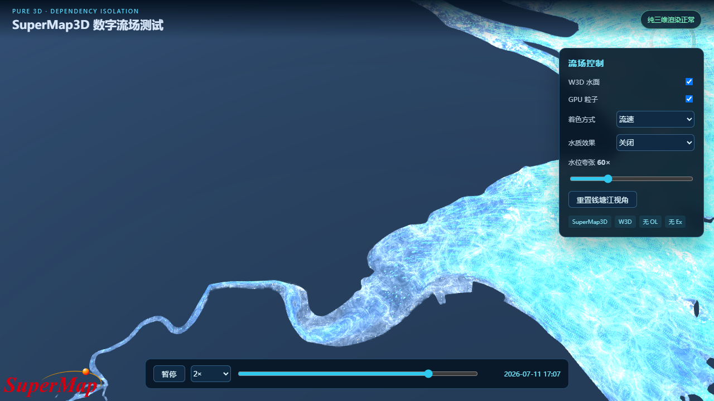

# SuperMap3D 纯三维数字流场测试

这是一个完全独立的纯三维兼容性测试，不加载 OpenLayers、SuperMap3DEx 或 MapSynchronizer。

## 运行

```bash
npm install
npm run build
npm run serve
```

浏览器访问：

```text
http://127.0.0.1:4181/
```

开发模式可运行：

```bash
npm run dev
```

## 核心依赖

```text
新 SuperMap3D 完整包
    ↓
SuperMap3D.Viewer
    ↓
W3D WaterFloodSimulation
    ↓
数字流场水面与 GPU 粒子层
```

详细依赖、目录和引入顺序见 [依赖引入说明](public/docs/dependency-integration.md)。

`public/data/flowfield/` 是内置的 72 时次样例，仅用于本地测试，不代表生产数据传输方式。

## 验证结果

- `SuperMap3D` 和 `w3d` 均为 `object`。
- `SuperMap3DEx` 和 `ol` 均为 `undefined`。
- WebGL2、W3D 水面、GPU 粒子、时间播放和水质切换正常。
- 最终浏览器控制台 0 error、0 warning，运行时依赖请求全部返回 200。


